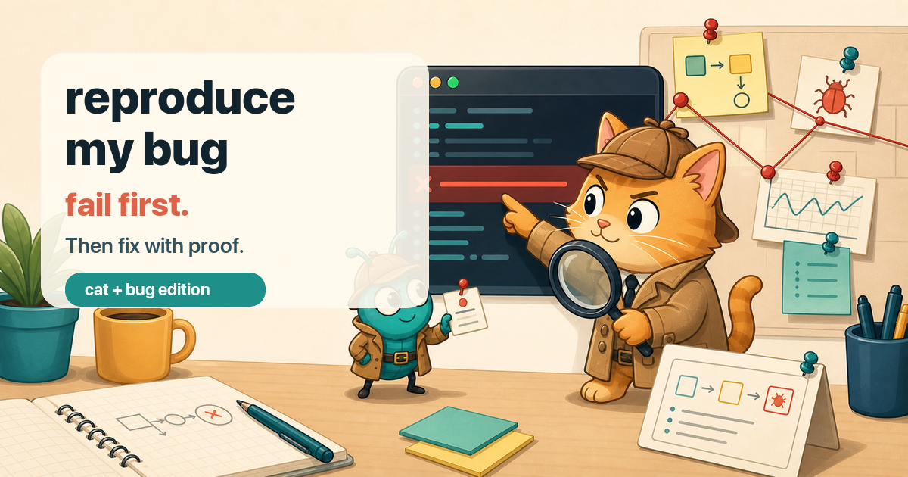

# reproduce-my-bug

**No fix without a failing reproduction — turn "it breaks sometimes" into
a test you can run on demand.**

`reproduce-my-bug` is an [agent skill](https://vercel.com/docs/agent-resources/skills)
for the half of debugging everyone skips. The most expensive words in
software are "I think I fixed it": a fix without a reproduction is a guess
with a commit message — nobody can prove it worked, and nothing stops the
bug from coming back. This skill **never fixes**. It proves: evidence
sweep → ranked hypotheses → the smallest failing test → minimized until
every remaining step is load-bearing.

## How it works

```
/reproduce-my-bug "checkout total goes negative sometimes, started last week"
```

1. **Intake** — symptom verbatim (paraphrasing deletes clues), expected vs
   actual, environment, frequency, first-seen. Unknowns marked `UNKNOWN`,
   never invented.
2. **Evidence sweep** — exact error text grepped to its throwing site,
   logs around (not just at) the incident, `git log`/`git bisect` around
   first-seen, the triggering data row diffed against a working one,
   environment diffs. Output: hypotheses **ranked by evidence, not by
   what training data says usually breaks** — the correlation trap
   ("started after deploy X" makes X a suspect, not a culprit) is called
   out explicitly.
3. **Path trace** — the code path from symptom backward, `file:line`
   mapped before building anything. A compact **Repro Plan Gate**
   confirms the top hypothesis and planned repro form before any heavy
   setup (containers, prod-like seeds, hammer rigs) is built.
4. **Reproduce** — attempt #0 proves the suspect path even runs locally,
   then one variable at a time, every attempt logged (failed attempts
   are eliminations, and unrecorded attempts get repeated). Preference
   order: failing test in the repo's own framework > repro script kept in
   the repo that checks its own outcome > documented manual steps (with
   the reason automation was impossible).
5. **Minimize** — remove anything; if it still fails, it was noise. What
   remains is the bug's true precondition list — often the root cause's
   silhouette — and every surviving element is proven load-bearing by a
   recorded removal attempt, not by impression.
6. **Flaky path** — "sometimes" gets its own protocol: measure the
   baseline rate, identify the nondeterminism source (races, clock,
   ordering, seeds, network, cache, test pollution — each with its tell
   and its forcing lever), then force determinism. Honest outcomes only:
   **DETERMINISTIC / RATE-BASED (8/10 + recipe) / NOT-YET-REPRODUCED**
   (shipped with the monitoring that will catch the next occurrence).
7. **The dossier** — `REPRO.md`: the one command that fails, verbatim red
   output, evidence timeline, killed hypotheses with their killers, and
   the handoff: **the failing test is the fix's acceptance criterion and
   the permanent regression guard.**

## The skill family

| Skill | Moment |
|-------|--------|
| [know-my-repo](https://github.com/silkyland/know-my-repo) | Day one: onboard onto a repo with zero knowledge |
| [deep-plan](https://github.com/silkyland/deep-plan) | Plan the next feature/refactor — evidence-gated, 8 phases |
| [deep-plan-ingest](https://github.com/silkyland/deep-plan) | Distill an implemented plan into living knowledge files |
| [scaffold-my-plan](https://github.com/silkyland/scaffold-my-plan) | Turn a plan's first milestone into a running first slice |
| [clean-slate](https://github.com/silkyland/clean-slate) | Reset rotten knowledge files — backup-gated |
| [transform-my-repo](https://github.com/silkyland/transform-my-repo) | Change the architecture: migration feasibility + strategy |
| **reproduce-my-bug** | Prove the bug before anyone fixes it |
| [audit-my-layout](https://github.com/silkyland/audit-my-layout) | Measure a live page's visual consistency, viewport by viewport |
| [ground-my-ui](https://github.com/silkyland/ground-my-ui) | Prove the UI's contracts before anyone redesigns |
| [ground-my-shopware](https://github.com/silkyland/ground-my-shopware) | Shopware 6 admin/storefront UI grounded in installed vendor source |
| [seed-ah](https://github.com/silkyland/seed-ah) | A world of ONE company that reads like it has been in use for a year |
| [love-me-love-my-docs](https://github.com/silkyland/love-me-love-my-docs) | A user manual that regenerates itself |

Shared law: **no claim without evidence** — here at its purest: the bug
itself must be demonstrated before it may be fixed.

## Install

```bash
npx skills add silkyland/reproduce-my-bug
```

Or copy this directory into your agent's skills folder
(e.g. `~/.claude/skills/reproduce-my-bug/`).

## Structure

```
reproduce-my-bug/
├── SKILL.md                          # 7-step workflow + hard rules (never fix, never prod)
└── references/
    ├── evidence-sweep.md             # Where to look + evidence-ranked hypotheses
    ├── repro-harness.md              # Failing tests, repro scripts, minimization, traps
    ├── flaky-bugs.md                 # Nondeterminism sources, forcing levers, rate protocol
    └── dossier-template.md           # REPRO.md structure + quality bar
```

Follows the [Vercel skills](https://github.com/vercel-labs/skills) single-skill
layout and [Anthropic's skill authoring best practices](https://platform.claude.com/docs/en/agents-and-tools/agent-skills/best-practices).

## License

MIT
